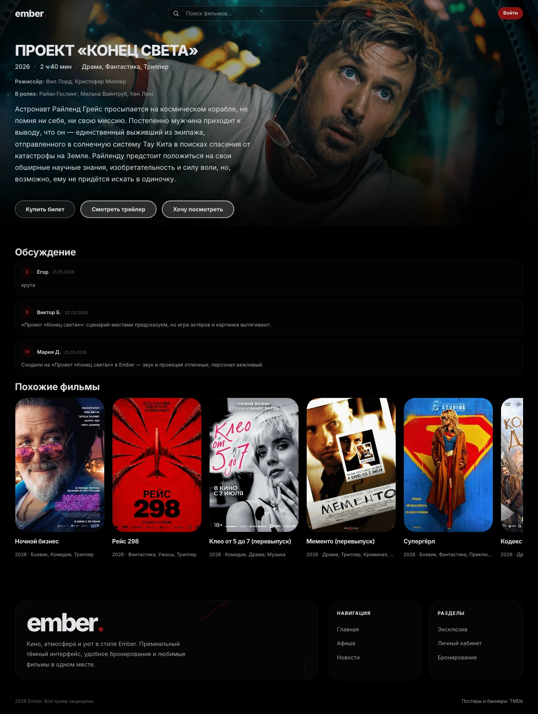
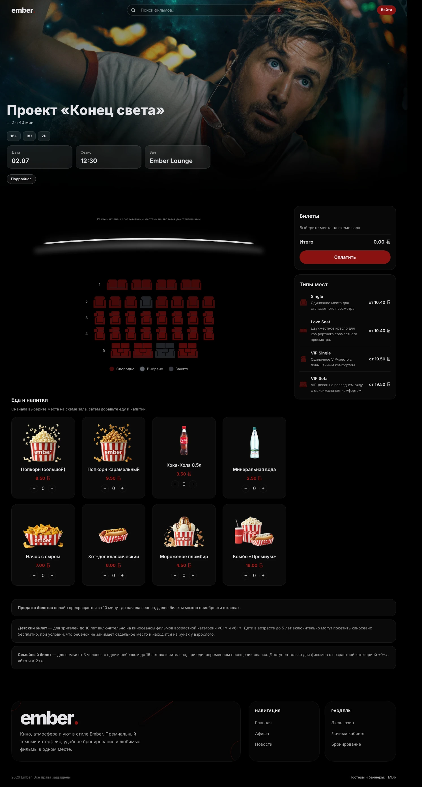

# Ember

Веб-приложение кинотеатра: афиша, поиск фильмов, расписание, выбор мест, корзина, билеты и личный кабинет. Интерфейс доступен на русском, английском и белорусском языках.

## Скриншоты

### Главная страница


<details>
<summary>Каталог фильмов</summary>


</details>

<details>
<summary>Страница фильма</summary>



</details>

<details>
<summary>Выбор мест и бронирование</summary>



</details>

## Технологии

- React 19, React Router, Vite 7, Tailwind CSS;
- ASP.NET Core 9, Entity Framework Core, SQLite;
- JWT, вход через Google, экспорт билетов в PDF и сеансов в календарь.

## Запуск

Нужны .NET SDK 9 и Node.js 22.12 или новее.

### Backend

Скопируйте `backend/CinemaApp.WebApi/appsettings.Local.example.json` в `appsettings.Local.json` в той же папке. Задайте собственный случайный `Jwt:Key` длиной от 32 байт. Локальные настройки не попадают в Git.

```bash
dotnet restore backend/CinemaApp.sln
dotnet run --project backend/CinemaApp.WebApi --urls http://localhost:5255
```

База `cinema.db` создаётся автоматически. При первом запуске добавляются демонстрационные фильмы, залы, сеансы и меню. Swagger доступен по адресу `http://localhost:5255/swagger` в режиме Development.

Чтобы создать администратора, укажите `Seed:AdminEmail` и `Seed:AdminPassword` в локальных настройках перед запуском. Существующим пользователям пароль не меняется. Общего пароля администратора в проекте нет.

### Frontend

```bash
cd frontend-react
npm ci
cp .env.example .env
npm run dev
```

Приложение откроется на `http://localhost:5173`. `VITE_API_URL` задаёт адрес API; по умолчанию используется `http://localhost:5255/api`.

### Google OAuth

Укажите одинаковый Client ID в `VITE_GOOGLE_CLIENT_ID` на frontend и `Google:ClientId` на backend. Client Secret храните только на backend в `appsettings.Local.json` или переменной `Google__ClientSecret`. В Google Cloud добавьте redirect URI `http://localhost:5173/auth`.

Параметры backend можно переопределять переменными окружения: `Jwt__Key`, `ConnectionStrings__DefaultConnection`, `Seed__AdminEmail`, `Seed__AdminPassword`. Для другого адреса frontend задайте разрешённые CORS origins через `Cors__Origins__0`, `Cors__Origins__1` и далее. Гостевые корзины используют HttpOnly cookie; при раздельном размещении frontend и API должны работать в пределах одного сайта.

## Проверки

Из корня проекта:

```bash
dotnet build backend/CinemaApp.sln
python3 tests/api_smoke.py
```

API-проверки запускают отдельный процесс с временной базой данных и отключённой синхронизацией афиши. Рабочая база не меняется.

```bash
cd frontend-react
npm run lint -- --max-warnings 0
npm test
npm run build
```

## Структура

```text
backend/
  CinemaApp.Domain/          сущности и перечисления
  CinemaApp.Data/            контекст и связи базы данных
  CinemaApp.Application/     сценарии, DTO и бизнес-правила
  CinemaApp.Infrastructure/  интеграции и демонстрационные данные
  CinemaApp.WebApi/          HTTP API и настройки приложения
frontend-react/
  src/components/           компоненты интерфейса
  src/pages/                страницы
  src/context/              состояние приложения
  src/hooks/                общая логика интерфейса
  src/i18n/                 переводы
  src/utils/                вспомогательные функции
  tests/                    проверки API-клиента и авторизации
tests/                      проверки backend через HTTP
```

## Демонстрационный режим

Оплата реализована через `StubPaymentProvider`: приложение моделирует оплату, реальные списания не выполняются. Формы карт предназначены для тестовых данных. В расписании и отзывах используются демонстрационные данные.

Афиша и изображения могут обновляться с mooon.by. Для автономного запуска установите `Mooon:Enabled` в `false`; для отключения только синхронизации при старте — `Mooon:SyncOnStartup` в `false`. При публикации учитывайте права на изображения, логотипы и материалы внешних источников.
